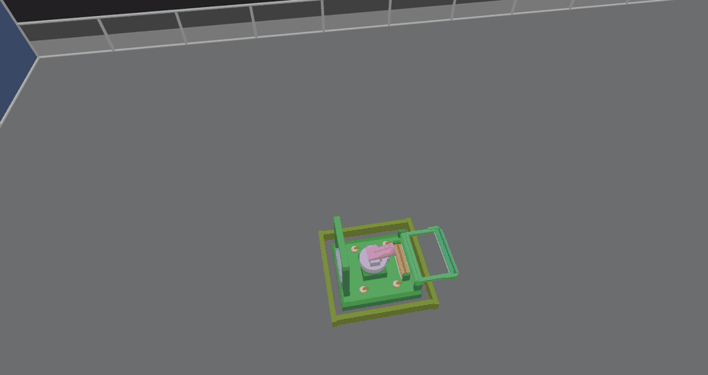

# Block Bot exercises

You are writing the subsystems and commands for a simulated block robot. Nothing is plugged in, but
the code you write is the code you would write on the real thing: a motor takes volts, an encoder
reports position, a command decides what to do about it.

Seven stages, in order: **roller → elevator → intake → hood → turret → swerve → odometry**. Only the
rollers are open loop. Every joint with somewhere to be — elevator, intake frame, hood, turret, each
swerve module's steering — ends up closed loop. The last two stages drive the robot around the field
and then work out where it went.

## What you are given

| File | Yours? | What it is |
|---|---|---|
| `Motor` | no | the motor a subsystem drives: volts in, position and velocity out |
| `Gyro` | no | the drivetrain's gyro: how far the robot has turned since power-on |
| `Motors` | no | the robot's physical world: one described motor per joint, plus the gyro |
| `RobotPhysics` | no | the plant in one unit-typed table: gearing, inertia, mass, gravity, wheels and carpet |
| `Carpet` | no | where the robot really is; you cannot read it, as on a real robot |
| `BlockBot` | no | draws the robot; you never touch a pose |
| `Robot` | edit | constructs mechanisms, registers drawers, binds buttons |
| `subsystems/<name>/<Name>Constants.java` | tune | unit-typed travel and voltage; gains |
| `Constants` | no | robot-wide values: loop period, controller port, field size and start pose |
| `assets/Robot_BlockBot/` | no | the 3D model |

There is no hardware layer, no IO interface, no replay. A mechanism owns its motors and its state, and
the physical behavior it runs against is given.

## The motor

```java
Motor feeder   = Motors.feederRoller();   // radians
Motor carriage = Motors.elevator();       // metres
Motor frame    = Motors.intakeFrame();    // radians, 0 flat
Motor roller   = Motors.intakeRoller();   // radians
Motor hood     = Motors.hood();           // radians, 0 level
Motor turret   = Motors.turret();         // radians, 0 forward
Motor drive0   = Motors.swerveDrive(0);   // radians at the wheel; module 0 is front-left
Motor steer0   = Motors.swerveSteer(0);   // radians, 0 rolls forward, unwrapped
Gyro gyro      = Motors.gyro();           // gyro.getYawRadians(), counter-clockwise positive

feeder.setVoltage(Volts.of(6.0));   // every loop while running
feeder.stop();
feeder.getPosition();
feeder.getVelocity();
```

You do not describe your motor. Gearing, inertia, mass, gravity and travel are facts about the robot,
written down once in `Motors`; on a real robot the physical world plays that role, and none of your
code changes when hardware replaces the simulation. What is behind the seam is a WPILib simulator —
and you do not touch that either. The motor advances itself once per loop, so you never call `update`.

## The pattern

Every mechanism is the same three pieces:

1. `implements Subsystem`, owns its motor as a field.
2. A command sets voltage; `finallyDo` stops the motor when the command ends or is interrupted.
3. A getter exposes joint state as a plain number, and `Robot` registers it once:

```java
m_blockBot.trackFeeder(m_roller::getSpinRadians);
```

4. `periodic()` posts the mechanism's own state every loop — the target where there is one, and the
   measurement always. Call `this.register()` at the end of the constructor (or let
   `setDefaultCommand` register for you); `Robot` never asks for the state:

```java
public Elevator() {
  this.setDefaultCommand(this.hold());   // registers the subsystem, default command included
}

@Override
public void periodic() {
  Logger.recordOutput("Elevator/TargetMeters", m_target.in(Meters));
  Logger.recordOutput("Elevator/PositionMeters", m_motor.getPosition());
}
```

Registration order matters: the motor registered its physics step when the field was constructed, and
the scheduler calls periodics in that order, so the step happens before your log. A subsystem with no
default command registers itself with `this.register()`.

An open-loop mechanism has no target and logs only the measurement
(`Roller/PositionRadians`, `Roller/VelocityRadiansPerSecond`). Key names carry their units, and the
values are base units — metres, radians — because that is what `Motor` returns.

Field names take an `m_` prefix, and a mechanism calls its own methods with `this.`
(`this.driveToTarget()`, `this.run(...)`); static constants stay `UPPER_SNAKE_CASE`.
Physical constants are unit-typed — `Distance`, `Angle`, `Voltage` — and converted with `.in(Meters)`
only at the motor.

**Open loop** (rollers) has no feedback: hold the button, apply volts, done.

**Closed loop** (every joint) needs two commands — one that holds position and one that moves to a new
position — sharing one control law:

```java
private Distance m_target = ElevatorConstants.MIN_HEIGHT;

public Elevator() {
  this.setDefaultCommand(this.hold());   // stay where you are when nothing else runs
}

private Command hold() {
  return this.run(this::driveToTarget).withName("Elevator.Hold");
}

public Command goTo(Distance height) {
  return this.run(() -> {
        m_target = height;
        this.driveToTarget();
      })
      .withName("Elevator.GoTo");
}

private void driveToTarget() {
  m_motor.setVoltage(
      Volts.of(ElevatorConstants.KP * (m_target.in(Meters) - m_motor.getPosition())));
}
```

`hold()` is bound explicitly with `setDefaultCommand`. Commands v2 then runs it whenever no other
command requires the subsystem, so a joint that never binds one simply stops driving when its command
ends (and droops, if gravity is simulated).

## Seeing your work

```powershell
.\scripts\sim.ps1
```

Then AdvantageScope (`%PUBLIC%\wpilib\2026\advantagescope`, or the newer dev build in
`~/Downloads/advantagescope-wpilib-win-x64`), `File` > `Connect to Simulator` > `NetworkTables
(AdvantageKit)`, tab **Block Bot 3D**, and enable teleop in the Sim GUI.

A joint you have not registered stays at its reference pose, so a mechanism you have not written simply
does not move.

## Stage 1 — Roller

Write `src/main/java/first/robot/subsystems/roller/Roller.java`.

- `Motors.feederRoller()`, driven open loop at `RollerConstants.VOLTAGE`.
- `runCommand()` sets the voltage every loop and stops the motor in `finallyDo`, named `"Roller.Run"`.
- Expose `getSpinRadians()` and register it: `m_blockBot.trackFeeder(m_roller::getSpinRadians);`.
- Post `Roller/PositionRadians` and `Roller/VelocityRadiansPerSecond` from `periodic()`.
- Bind it to A: `RobotModeTriggers.teleop().and(m_driverController.a()).whileTrue(...)`.

Done when: holding A spins the roller up — you can see the ramp — and releasing it coasts down.

## Stage 2 — Elevator

New file `subsystems/elevator/Elevator.java`.

- `Motors.elevator()`: the carriage travels **0 to 0.26 m**, 25:1 gearbox, 5 kg carriage, 20 mm
  drum, lifting against gravity. The plant is in `RobotPhysics`, the limits in `ElevatorConstants`;
  you declare neither.
- Hold X → `goTo(ElevatorConstants.MAX_HEIGHT)`, hold Y → `goTo(ElevatorConstants.MIN_HEIGHT)`.
  Tune `ElevatorConstants.KP` (preset near 20 V/m).
- With gravity in the model, a pure P loop settles slightly below its target. That steady-state error
  is the point — think about what fixes it.

Wire it: `m_blockBot.trackCarriage(m_elevator::getHeightMeters);` and post
`Elevator/TargetMeters` alongside `Elevator/PositionMeters`. Graph the two: the gap that remains
at the top of the move is the steady-state error below.

Done when: the carriage rises smoothly, stops at the top, holds when you let go, and settles only
slightly under a commanded height.

## Stage 3 — Intake

New file `subsystems/intake/Intake.java`. One mechanism, **two motors** — this is where the two kinds
of control meet.

- Frame: `Motors.intakeFrame()`, **0 rad flat to π/2 upright**, gravity on.
- Roller: `Motors.intakeRoller()`, open loop at `IntakeConstants.ROLLER_VOLTAGE`.
- Hold A → stow (`IntakeConstants.FRAME_MAX_ANGLE`), hold Y → deploy
  (`IntakeConstants.FRAME_MIN_ANGLE`), hold X → spin the roller. Tune `IntakeConstants.FRAME_KP`
  (preset near 4 V/rad).

Wire it: `m_blockBot.trackIntake(m_intake::getFrameAngleRadians, m_intake::getRollerRadians);` and
post `Intake/FrameTargetRadians`, `Intake/FrameRadians`, and `Intake/RollerRadiansPerSecond`.

Done when: the frame swings and holds at either end, and the roller spins without moving the frame.

## Stage 4 — Hood

New file `subsystems/hood/Hood.java`.

- `Motors.hood()`, pitch **±15°** (±0.262 rad), gravity on — unpowered, it droops to the lower stop.
- Hold X → aim up (`HoodConstants.MAX_PITCH`), hold B → aim down (`HoodConstants.MIN_PITCH`);
  nothing held, the hold command keeps it there. Tune `HoodConstants.KP` (preset near 20 V/rad).

Wire it: `m_blockBot.trackHood(m_hood::getPitchRadians);` and post `Hood/TargetRadians` alongside
`Hood/PitchRadians`.

Done when: the hood holds an angle with nothing pressed, and droops only if you remove the hold.

## Stage 5 — Turret

New file `subsystems/turret/Turret.java`.

- `Motors.turret()` about the vertical axis, gravity **off** (yaw does not fall), limits **±π** from
  the cable wrap rather than from the mechanism.
- Tune `TurretConstants.KP` (preset near 3 V/rad).

Wire it: `m_blockBot.trackTurret(m_turret::getYawRadians);` and post `Turret/TargetRadians`
alongside `Turret/YawRadians`.

Done when: the turret holds wherever you point it, and a full sweep never drives the barrel into the
elevator — that clearance is proven at every angle, so if it clips, your angle is wrong.

## Stage 6 — Swerve drive

New file `subsystems/drive/Drive.java`. Four modules, each a drive motor and a steer motor, and the
gyro: `Motors.swerveDrive(i)`, `Motors.swerveSteer(i)` for `i` 0 to 3 (front-left, front-right,
back-left, back-right), and `Motors.gyro()`.

The geometry is the robot's, not yours: build `new SwerveDriveKinematics(RobotPhysics.Drive.MODULE_LOCATIONS)`
and turn wheel radians into metres with `RobotPhysics.Drive.WHEEL_RADIUS`. Speeds and gains are in
`DriveConstants`.

Every loop, for the `ChassisSpeeds` you want:

1. `ChassisSpeeds.discretize(speeds, 0.02)`, then `kinematics.toSwerveModuleStates(...)`, then
   `SwerveDriveKinematics.desaturateWheelSpeeds(states, DriveConstants.MAX_SPEED)`.
2. Per module, read where it points now — `new Rotation2d(steer.getPosition())` — then
   `state.optimize(current)` so it never turns more than 90°, and `state.cosineScale(current)` so it
   does not drive hard while still turning.
3. Steer closed loop: `STEER_KP * MathUtil.angleModulus(target − current)`. The steer encoder is
   unwrapped — it keeps counting past a full turn — so the error must be wrapped, or a module at
   `3π` will spin all the way round to reach `π`.
4. Drive feedforward plus feedback: `DRIVE_KV * speed + DRIVE_KP * (speed − measured)`, where
   `measured` is `drive.getVelocity()` times the wheel radius.

Drive field-relative from the sticks as the default command:
`ChassisSpeeds.fromFieldRelativeSpeeds(vx, vy, omega, new Rotation2d(gyro.getYawRadians()))`, with
`vx` from `-getLeftY()`, `vy` from `-getLeftX()` and `omega` from `-getRightX()`, each through
`MathUtil.applyDeadband(..., STICK_DEADBAND)` and scaled by `MAX_SPEED` / `MAX_ANGULAR_SPEED`.

Keyboard 0 has three axes: A/D (left X), W/S (left Y) and E/R, which holds its value instead of
springing back. `getRightX()` reads axis 4, so to turn from the keyboard open **DS → Keyboard 0
Settings** in the Sim GUI, raise the axis **Count** to 5, and give **Axis 4** a Decrease and an
Increase key (say Q and E — clear E from Axis 2 first) with a **Decay Rate** like Axis 0's. A real
controller needs none of this.

Post `Drive/ModuleStates` (measured) and `Drive/ModuleSetpoints` as `SwerveModuleState[]`;
AdvantageScope's Swerve tab draws both.

**You do not know where the robot is, and this stage does not need you to.** The 3D view draws the
robot where the simulated carpet put it — `Robot/Pose` is the world's truth, which your code cannot
read, just as a real robot cannot. The carpet is not a perfect servant: each wheel grips only up to
`WHEEL_COF` times its share of the weight, so a hard launch or a shove against a wall makes the wheels
spin. Watch `Carpet/SlipMetersPerSecond` and `Carpet/WallContact` while you drive.

Done when: the robot drives around the field, "forward" on the stick is away from the blue wall
whatever way the robot faces, and no module ever swings more than a quarter turn to change direction.

## Stage 7 — Odometry



Add odometry to `Drive`: a `SwerveDriveOdometry` built from your kinematics, the gyro's angle, the
four module positions and `Constants.Field.START_POSE` — the carpet sets the robot down there, so
odometry that starts anywhere else is wrong from the first loop. A module position is distance rolled
(`drive.getPosition()` times the wheel radius) and the steer angle. Update it at the top of
`periodic()` and post the result as `Drive/EstimatedPose` (`Pose2d`).

The Block Bot tab already has a green ghost listening on that key: the ghost is where your code thinks
the robot is, the solid robot is where it is. Then make them disagree, and explain each one:

- **Drive gently.** The ghost should sit on the robot.
- **Launch from rest at full stick.** The drive current limit sits a little above the slip current,
  so the wheels spin before the robot moves and the ghost runs ahead.
- **Drive into a wall and keep pushing.** The bumpers stop; the wheels do not. The ghost drives on
  through the wall.
- **Spin in place for ten turns.** Heading creeps: the gyro reads `GYRO_SCALE_ERROR` too much.

Then fix what you can from your own side — limit acceleration with a `SlewRateLimiter` so the wheels
never ask the carpet for more than it gives, and reset odometry when the robot is somewhere you know.
What you cannot fix from wheels and a gyro alone is why robots also look at the field.

Stretch: write the odometry yourself. Each loop, take the change in every module position,
`kinematics.toTwist2d(deltas)`, replace its rotation with the gyro's change, and `pose.exp(twist)`.
Post it beside WPILib's and graph the difference.

Done when: the ghost follows the robot through ordinary driving, and you can make it leave the robot
on purpose and say why every time.

## Gotchas

- **Disable cancels commands** and `finallyDo` runs. A joint that must stay put needs a hold command,
  not a voltage left behind by a cancelled one.
- **Bind in the `Robot` constructor.** Trigger bindings live on the scheduler's default button loop,
  which is polled every loop, so a binding you add at construction keeps working across mode changes.
- **`whileTrue` is the resume-after-disable binding.** It schedules when the composed condition rises
  and cancels when it falls, and the condition includes `teleop()` (mode and enabled), so holding a
  button through a disable re-schedules the command on enable.
- **Default commands are scheduled automatically** once you set one, and cannot require another
  subsystem.
- **Two commands requiring the same subsystem cannot run together** — the second preempts the first.
- **Re-assert voltage every loop.** `setVoltage` is not a latch.
- **Ask for each drivetrain part once.** A second `Motors.swerveDrive(0)` throws: there is one
  front-left wheel.
- **Wrap steering error, not steering position.** The steer encoder counts past a full turn on purpose.
- **Do not edit `Motor`, `Motors`, `BlockBot`, `Carpet`, or the logging setup in `Robot`.** No stage
  needs it.
