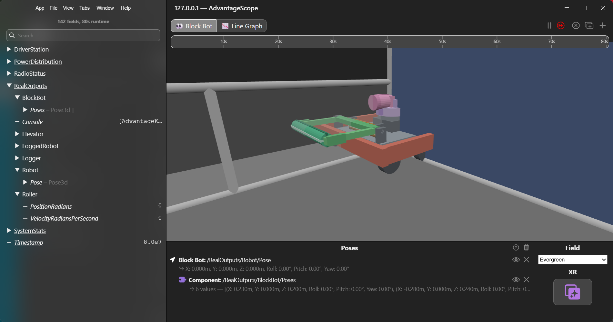

# Block Bot — WPILib 2026

A simulated FRC robot for learning command-based code: one Kraken X60 per joint, real mechanism
physics, and a 3D view of every joint in AdvantageScope. Nothing is plugged in.



The five exercises — roller, elevator, intake, hood, turret — are in [EXERCISES.md](EXERCISES.md).
This page gets the simulator and the 3D view running; then you write the first stage.

## What you need

- WPILib **2026** with VS Code. It installs Java, the WPILib simulator, and AdvantageScope.
- A terminal. The helper scripts are PowerShell.

## 1. Build

```powershell
git clone https://github.com/laviRZ/basicsim26.git
cd basicsim26
.\scripts\build.ps1
```

Wait for `BUILD SUCCESSFUL`.

## 2. Start the simulator

```powershell
.\scripts\sim.ps1
```

A **Robot Simulation** window opens. Before driving:

1. **Robot State** → click **Teleoperated**.
2. **System Joysticks** → drag **Keyboard 0** onto **Joystick[0]**.


`Keyboard 0` turns four keys into controller buttons: **Z** is A, **X** is B, **C** is X, **V** is Y.

## 3. Add the 3D view

Open AdvantageScope (installed with WPILib), then:

1. **File → Connect to Simulator → NetworkTables 4 (AdvantageKit)** (or `Ctrl+Shift+K`).
2. **File → Import Layout…** and choose `ascope/BlockBot.json`.

Importing a layout closes the window. Open AdvantageScope again and repeat step 1: the Block Bot
tab is now saved.


## 4. Write the roller

Add `src/main/java/first/robot/subsystems/roller/Roller.java`: the roller's motor, its command, and
`getSpinRadians()`.

Then in `Robot.java`:

- construct the roller beside `m_blockBot`,
- register its pose with `m_blockBot.trackFeeder(m_roller::getSpinRadians);`,
- bind its command in `configureButtonBindings()`:

```java
RobotModeTriggers.teleop().and(m_driverController.a()).whileTrue(m_roller.runCommand());
```

[EXERCISES.md](EXERCISES.md) stage 1 has the details.

## 5. Check it works

Hold **Z**. With a **Line Graph** tab (`Alt+G`) showing **Roller → PositionRadians** and
**Roller → VelocityRadiansPerSecond**, it should look like this:


Velocity jumps to about 105 rad/s while you hold Z, and position climbs steadily. Release Z: the
velocity falls back and the position flattens.

## If something does not work

- **Nothing moves.** The DriverStation panel must say `Robot Enabled: Yes`, `Joystick[0]` must show
  `16: Keyboard 0`, and you must be holding Z. Its first LED lights while Z is held.
- **No data in AdvantageScope.** Connect to the simulator again (`Ctrl+Shift+K`). Only one simulator
  can run at a time, so close any other Robot Simulation window first.
- **The robot is missing from the 3D view.** Restart AdvantageScope after starting the simulator.
