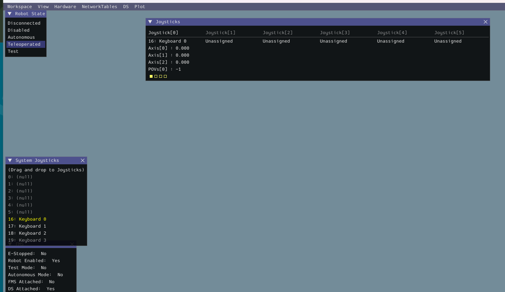
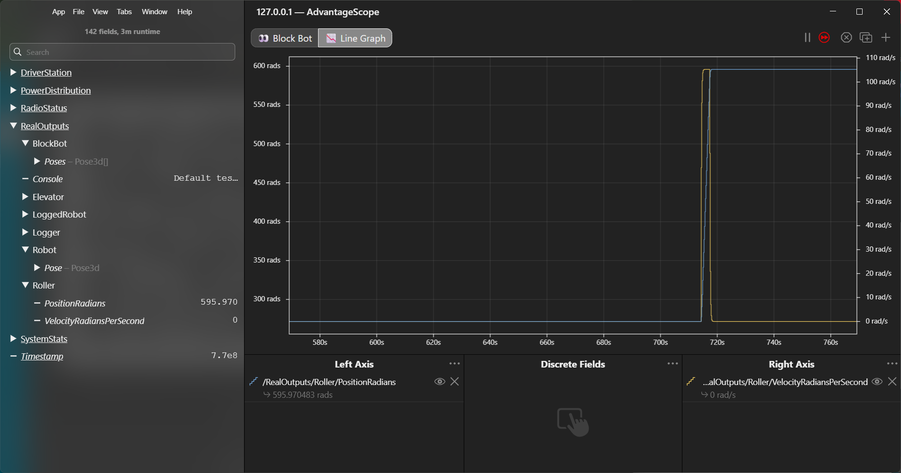

# Block Bot — WPILib 2026

A simulated FRC robot for learning command-based code: one Kraken X60 per joint, real mechanism
physics, and a 3D view of every joint in AdvantageScope. Nothing is plugged in.


The five exercises — roller, elevator, intake, hood, turret — are in [EXERCISES.md](EXERCISES.md).
This page goes from a fresh clone to the stage-1 roller spinning.

## What you need

- WPILib **2026** with VS Code. It installs Java, the WPILib simulator, and AdvantageScope.
- A terminal. The helper scripts are PowerShell.

## 1. Build

```powershell
git clone https://github.com/laviRZ/basicsim26.git
cd basicsim26
.\scripts\build.ps1
```

Wait for `BUILD SUCCESSFUL`.

## 2. Start the simulator

```powershell
.\scripts\sim.ps1
```

A **Robot Simulation** window opens. Before driving:

1. **Robot State** → click **Teleoperated**.
2. **System Joysticks** → drag **Keyboard 0** onto **Joystick[0]**.



`Keyboard 0` turns four keys into controller buttons:

| Key | Xbox button | Bound command |
|---|---|---|
| **Z** | A | `Roller.runCommand()` |
| **X** | B | unbound |
| **C** | X | `Elevator.goTo(MAX_HEIGHT)` |
| **V** | Y | `Elevator.goTo(MIN_HEIGHT)` |

## 3. Add the 3D view

Open AdvantageScope (installed with WPILib), then:

1. **File → Connect to Simulator → NetworkTables 4 (AdvantageKit)** (or `Ctrl+Shift+K`).
2. **File → Import Layout…** and choose `ascope/BlockBot.json`.

Importing a layout closes the window. Open AdvantageScope again and repeat step 1: the Block Bot
tab is now saved.


## 4. Hold Z

Z is the A button. `Robot` binds it to the roller, so holding it applies
`RollerConstants.VOLTAGE` every loop; releasing it stops the motor.

To watch the numbers, add a **Line Graph** tab (`Alt+G`), drag **Roller → PositionRadians** and
**Roller → VelocityRadiansPerSecond** into it, then hold Z for a few seconds:



Velocity jumps to about 105 rad/s while you hold Z, and position climbs steadily. Release Z: the
velocity falls back and the position flattens.

## Where to write code

| File | What it is |
|---|---|
| `Motor.java`, `Motors.java`, `RobotPhysics.java` | the motor and the robot's physical plant — given |
| `BlockBot.java` | the 3D poses — given |
| `Robot.java` | constructs each mechanism, registers its pose, binds buttons |
| `subsystems/<name>/` | your subsystem, its commands, and its constants |

## If something does not work

- **Nothing moves.** The DriverStation panel must say `Robot Enabled: Yes`, `Joystick[0]` must show
  `16: Keyboard 0`, and you must be holding Z. Its first LED lights while Z is held.
- **No data in AdvantageScope.** Connect to the simulator again (`Ctrl+Shift+K`). Only one simulator
  can run at a time, so close any other Robot Simulation window first.
- **The robot is missing from the 3D view.** Restart AdvantageScope after starting the simulator.
