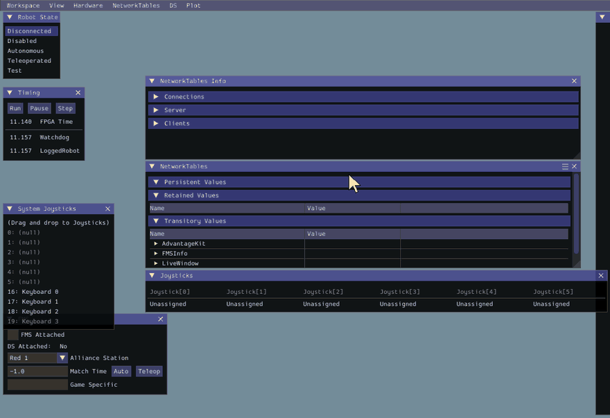
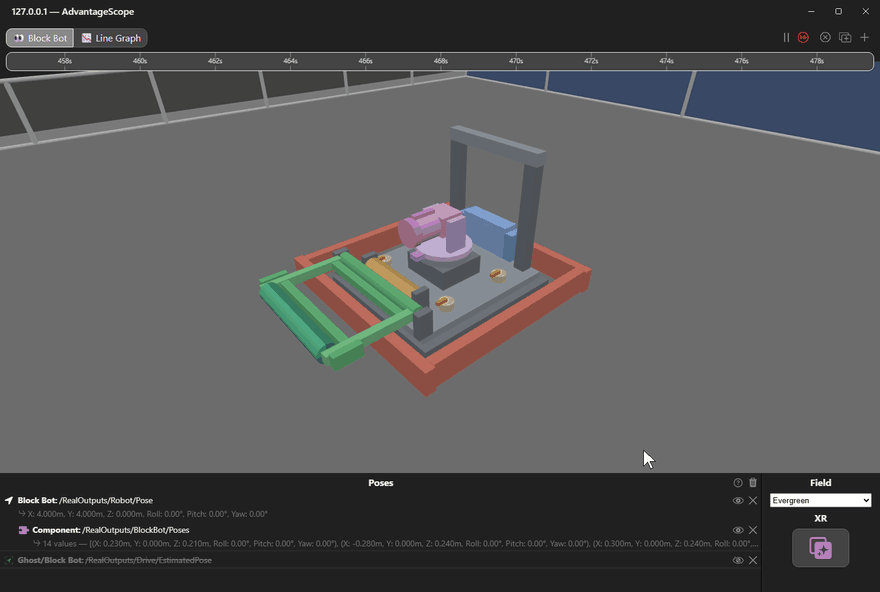
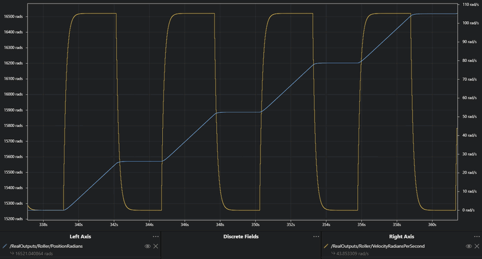
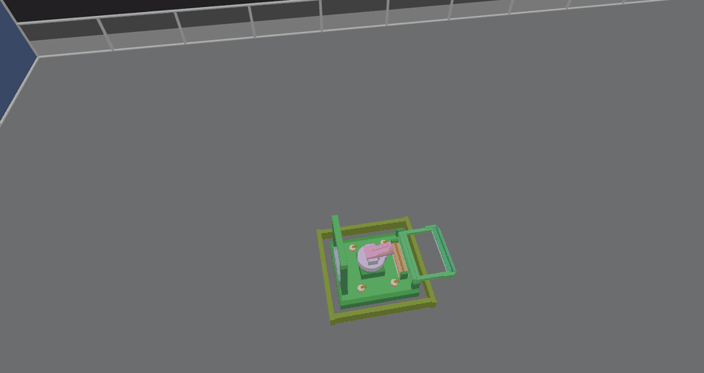

# Block Bot — WPILib 2026

A simulated FRC robot for learning command-based code: one Kraken X60 per joint, real mechanism
physics, a swerve drivetrain on a simulated carpet, and a 3D view of every joint in AdvantageScope.
Nothing is plugged in.


The seven exercises — roller, elevator, intake, hood, turret, swerve, odometry — are in
[EXERCISES.md](EXERCISES.md). This page gets the simulator and the 3D view running; then you write the
first stage.

## What you need

- WPILib **2026** with its VS Code. It installs Java, the WPILib simulator, and AdvantageScope.

## 1. Build

Get the project, with **Git: Clone** in VS Code or in a terminal:

```
git clone https://github.com/laviRZ/basicsim26.git
```

Open the `basicsim26` folder in the WPILib VS Code. Press `Ctrl+Shift+P`, run **WPILib: Build Robot
Code**, and wait for `BUILD SUCCESSFUL`.

## 2. Start the simulator

Press `Ctrl+Shift+P` and run **WPILib: Simulate Robot Code**. When it asks which extensions to use,
keep **Sim GUI** ticked and press Enter.

A **Robot Simulation** window opens. Before driving:

1. **Robot State** → click **Teleoperated**.
2. **System Joysticks** → drag **Keyboard 0** onto **Joystick[0]**.



`Keyboard 0` turns four keys into controller buttons: **Z** is A, **X** is B, **C** is X, **V** is Y.

## 3. Add the 3D view

First, give AdvantageScope the Block Bot model: in the project's `scripts` folder, double-click
**`setup-advantagescope.cmd`**. Do it once, before you open AdvantageScope. Without it, the 3D view
shows AdvantageScope's own KitBot instead.

Then open AdvantageScope (installed with WPILib):

1. **File → Connect to Simulator → NetworkTables 4 (AdvantageKit)** (or `Ctrl+Shift+K`).
2. **File → Import Layout…** and choose `ascope/BlockBot.json`.

Importing a layout closes the window. Open AdvantageScope again and repeat step 1: the Block Bot
tab is now saved.



Drag to orbit, scroll to zoom. With no code written yet every part sits still in its starting position and
the robot stands at its start position.

## 4. Write the roller

Add two classes in `src/main/java/first/robot/subsystems/roller/`: `Roller.java`, the subsystem that
owns the roller's motor, and `RunRoller.java`, the command that spins it.

Then in `Robot.java`:

- construct the roller beside `m_blockBot`,
- bind its command in `configureButtonBindings()`:

```java
RobotModeTriggers.teleop().and(m_driverController.a()).whileTrue(new RunRoller(m_roller));
```

[EXERCISES.md](EXERCISES.md) stage 1 has the details. Close the simulator window and run **WPILib:
Simulate Robot Code** again to try your code.

## 5. Check it works

Hold **Z**. With a **Line Graph** tab (`Alt+G`) showing **Roller → PositionRadians** and
**Roller → VelocityRadiansPerSecond**, it should look like this:



Velocity jumps to about 105 rad/s while you hold Z, and position climbs steadily. Release Z: the
velocity falls back and the position flattens.

## Later: swerve and odometry

The last two stages drive the robot. The simulator plays the world's part: it decides where the robot
really goes on the carpet — wheels grip up to a limit and slip past it, bumpers stop at the walls —
and the 3D view draws that, so the robot drives before your code knows where it is. In the final
stage you work that out from wheel encoders and the gyro, and a green ghost shows your answer beside
the real robot:



## If something does not work

- **Nothing moves.** The DriverStation panel must say `Robot Enabled: Yes`, `Joystick[0]` must show
  `16: Keyboard 0`, and you must be holding Z. Its first LED lights while Z is held.
- **No data in AdvantageScope.** Connect to the simulator again (`Ctrl+Shift+K`). Only one simulator
  can run at a time, so close any other Robot Simulation window first.
- **The 3D view shows a different robot (the KitBot), or none.** Double-click
  `scripts\setup-advantagescope.cmd`, then close AdvantageScope completely and open it again: it
  loads robot models only when it starts. If it is still the KitBot, import `ascope/BlockBot.json`
  again (step 3).
- **The build fails because a file is in use.** A simulator is still running. Close its window and
  build again.
